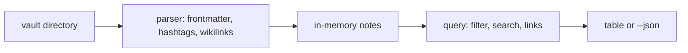

<div align="center">

# `vori`

**A read-only command line tool that queries a folder of Markdown notes (frontmatter, hashtags, wikilinks)
for people who keep notes in Obsidian-style vaults.**

[](https://www.npmjs.com/package/@questi0nm4rk/vori)
[](https://github.com/Questi0nM4rk/vori/actions/workflows/ci.yml)
[](./LICENSE)

</div>

```console
$ vori query notes/ --tag status=draft
NAME    TITLE   HASHTAGS
──────  ──────  ──────────
idea-a  idea-a  typescript

1 note(s)

$ vori backlinks notes/ idea-a
Incoming links to: idea-a

  idea-b  (idea-b.md)
```

## Why it exists

Agents and scripts that need to read a notes vault have only two choices today.
They open the Obsidian app, or they grep Markdown and miss the structure (frontmatter keys, hashtags, links).
vori reads that structure directly from the files and prints a table or JSON.
It never writes to a vault, so an agent can call it without risk.
It would have no reason to exist if the vault tools in Obsidian itself could be called from a shell.

## Quickstart

Tested with Bun 1.3.14.

```bash
bun install && bun test
```

Expected: `67 pass`, `0 fail`.

```bash
bun src/main.ts list ./docs
```

Expected: a table with the columns NAME, TITLE, HASHTAGS, WIKILINKS and one row per `.md` file.

To install the published package instead: `bun add -g @questi0nm4rk/vori`.

Other checks: `bun run typecheck` and `bun run lint`. Commands, flags and filter rules are in [docs/guide.md](docs/guide.md).

## How it works



Every command reads all `.md` files on each run. There is no index and no cache.
No part of vori calls a model. Everything is deterministic.
The title of a note is its first `# H1`, or the file name if there is none.
The one runtime dependency is `yaml`.

## Numbers

Measured 2026-10-12 on Arch Linux, Bun 1.3.14. Times vary by machine and run.

| What | Value | How measured |
| --- | --- | --- |
| Tests | 67 pass, 0 fail | `bun test` |
| Test run time | about 0.25 s (226 to 244 ms over two runs) | `bun test` (last line) |
| Source plus test code | 1,112 lines of code | `scc src __tests__` |
| npm bundle size | 250,473 bytes | `bun run build:npm`, then `wc -c bin/vori.js` |
| Compiled binary size | 94,832,768 bytes (about 90 MB, includes the Bun runtime) | `bun run build`, then `ls -l bin/vori` |
| Search over 1,000 generated notes | about 0.07 s median of 5 runs | `time bun bin/vori.js search <vault> "Note 500"` |
| Search over 10,000 generated notes | about 0.23 s median of 5 runs | same command, 10,000 notes |

The generated notes are small (one short paragraph each).
A real vault with long notes will be slower. Each time includes the start-up of Bun.

Commits include agent-authored work under my identity;
design, orchestration and review are mine.

## Status

- **Works:** `list`, `query`, `tags`, `links`, `backlinks`, `orphans`, `search`, `recent`, and `--json` on all of them.
  Published to npm as `@questi0nm4rk/vori` 1.0.0.
- **Experimental:** None.
- **Known gaps:**
  - No index: every call parses the whole vault.
  - No GitHub release exists. The compiled binary is about 90 MB and is not published.
  - The `title` frontmatter key is not used for the display name.
  - Only tested on Linux.

## License

MIT
